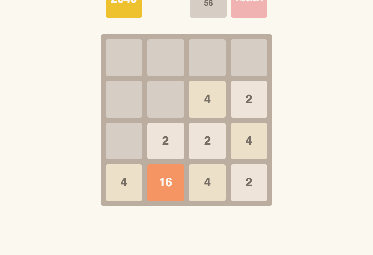

# 2048

**The classic sliding-tile puzzle, built in vanilla JavaScript with no frameworks.**

[](https://kasianeno.github.io/2048-game/)


[](LICENSE)

[](https://kasianeno.github.io/2048-game/)

**[Play it in the browser →](https://kasianeno.github.io/2048-game/)**

## How to play

Use the **arrow keys** to slide all tiles. Two tiles with the same number merge into one with their sum. Reach the **2048** tile to win. The game ends when the board is full and no merge is possible.

## Features

- 4 × 4 board stored as a two-dimensional array and re-rendered after each move
- Slide-and-merge logic for all four directions, with each tile merging at most once per move
- A new tile after every move: **2** with 90% probability, **4** with 10%
- Running score that adds the value of every merged tile
- Win message on reaching 2048 and a game-over message when no moves are left
- Start and Restart button that resets the board and the score

## Tech stack

| | |
|---|---|
| Logic | JavaScript (ES6), DOM API, keyboard events |
| Styles | SCSS with a colour for each tile value |
| Tooling | Parcel, ESLint, Stylelint, GitHub Actions for linting |

## Run locally

```bash
git clone https://github.com/kasianeno/2048-game.git
cd 2048-game
npm install
npm start
```

## Project structure

```
src/
├── index.html          # board, score and messages
├── scripts/main.js     # game state, moves, merging, win and lose checks
└── styles/main.scss    # board layout and tile colours
```
